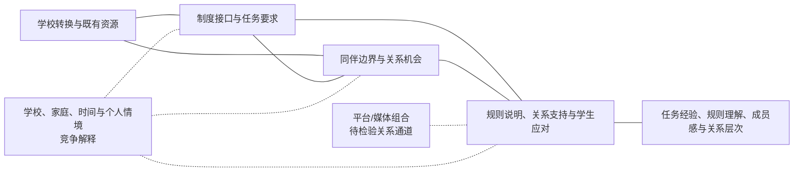

# 最终分析框架

## 最小概念组合

最终只保留四组核心概念：

1. **制度接口与学术社会化**：教学语言、任务、评价、分组和学校规则是学生具体遇到制度差异的位置。
2. **同伴边界与关系机会**：语言、本地知识或背景差异只有在具体互动中影响参与时才构成边界；邀请、邻近、共同任务和日常活动是关系机会。
3. **关系功能与支持可用性**：同伴、教师、家庭及校外资源可分别提供规则说明、信息、情绪、陪伴或参与入口；获得不等于充分。
4. **多维结果**：任务困难、规则理解、成员感、可求助性、亲密关系、网络构成和身份表达彼此相关但不可互换。

数字平台作为辅助的**媒体组合**放在关系功能之内，用于描述旧关系、学校信息和不同受众的通道，不另设平台效果理论。时间、学校环境、家庭资源和个人偏好作为跨层情境，用来产生竞争解释。

## 为什么弱化其他框架

- 隐性课程只用于明确“未说明且经试错/后果发现”的候选程序，不能覆盖所有制度困难。
- 学习者身份用于解释“好学生”标准与能力判断，但既有资本转译机制证据弱。
- 文化中介只保留具体行为层；稳定身份与网络位置不支持。
- 多媒介/媒体组合可整理问卷平台组合，但没有访谈机制链。
- 时间轨迹只能组织回顾节点，不是实际纵向过程模型。
- 能动性—结构和生态/制度情境是审查镜头，不是已验证效应理论。

## 框架图

实线无向连接表示当前资料支持把相应分析域共同考察，不表示方向。虚线表示待检验关系或竞争解释。

## 关系支持程度

| 关系 | 支持 | 主要证据 | 替代解释/不能验证 |
|---|---|---|---|
| 既有资源—制度接口 | 中等 | 背景题与三案语言/任务叙述 | 不能识别资源的独立效果 |
| 既有资源—同伴边界 | 中等 | 语言、旧关系与关系入口叙述 | 一般转校、年龄、班级构成 |
| 制度接口—同伴机会 | 中等 | 小组任务、自由分组、座位与邀请 | 完整机制链主要单案 |
| 制度/同伴接口—支持应对 | 中等 | 同伴说明、家庭资源、教师介入 | 时机与效果不能识别 |
| 支持应对—多维结果 | 较弱（探索性） | 回顾叙述与支持三状态 | 需要严重度、选择和基线控制 |
| 媒体组合—关系实践 | 较弱（待后续检验） | 问卷功能自报 | 访谈无平台事件链 |
| 情境—各接口 | 强审查镜头，非效应证据 | 家庭作息、费用、性格、评价与路径反例 | 不是学校/家庭效应估计 |

## 后续检验

后续研究应预先固定资格口径，采用多波调查、课堂/小组观察、关系网络和数字日记，分别记录规则是否明确、谁解释、学生如何行动、他人如何回应及随后发生什么。只有这种设计才能检验图中的方向、反馈或平台通道。
