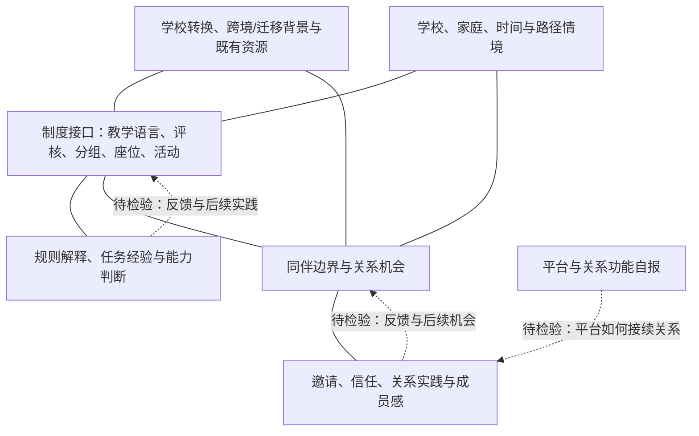

# 提议的综合分析框架（第三轮）

本框架是组织现有证据和后续问题的**分析框架**，不是已验证模型。

## 构念

- **既有资源**：学校转换前形成的语言、学习实践、关系和家庭资源；迁居只是部分参与者的背景，不预设资源在香港必然增值或贬值。
- **制度接口**：学生具体接触学校规则之处，如课堂发言、评核、分组、座位和活动安排。
- **同伴边界/关系机会**：差异在互动中被激活，以及被邀请、解释、信任或共同活动的机会。
- **规则解释与身份调整**：理解未明说规则，并重新界定能力、“好学生”和可用优势。
- **平台配置**：按受众和功能安排旧关系、学校信息与本地参与；平台品牌不是身份指标。
- **结果域**：规则掌握、任务体验、关系结构、成员感和具体中介经验；彼此可不同步。

## 连接的支持程度与不能验证之处

| 连接 | 图示 | 支持 | 竞争解释/边界 |
|---|---|---|---|
| 学校转换/既有资源—制度接口 | 实线无向 | moderate：问卷背景与三案接口并置 | 不支持具体迁居、年级或学校类型效应 |
| 学校转换/既有资源—同伴机会 | 实线无向 | moderate：既有语言/关系与入口叙述并存 | 一般转校、性格和班级构成 |
| 制度接口—规则/任务经验 | 实线无向 | strong description：任务困难与规则理解均有完整样本资料 | 不表示未明说规则或时间变化 |
| 制度接口—同伴机会 | 实线无向 | moderate：分组/座位与邀请事件 | 完整机制链主要单案 |
| 同伴机会—关系/成员感 | 实线无向 | strong description：边界、邀请、成员感均有证据 | 不识别方向或效应 |
| 情境—制度/同伴接口 | 实线无向 | strong as audit lens | 家庭、学校或时间独立效应不支持 |
| 平台—关系实践 | 虚线 | weak / 待检验 | 访谈无平台—受众—功能事件链 |
| 两条反馈 | 虚线 | plausible but under-evidenced | 回顾顺序不是纵向观察 |

实线无向连接只表示当前资料支持把两个分析域共同考察；虚线表示待检验关系。图不表达因果、发展顺序、效应大小或反事实。

竞争解释包括入学年级、学校和班级构成、教学语言、评核压力、家庭时间/成本、个性及访谈回忆。家庭资源和学校环境不是背景噪音，而是可能改变机会与策略可用性的情境。

## 理论意义与后续检验

数据支持以“接口—机会—实践—多维结果”替代单一融入终点，也要求严格区分网络位置、具体中介行为和中介身份。后续研究可用入学前后多波调查、课堂/小组观察、关系网络与数字日记，并分别测量事件、解释、行为、他人认可和结果；检验应比较替代路径，而非预设所有学生走同一适应序列。
